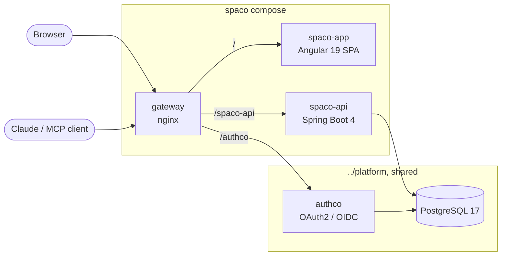

<div align="center">


# Spaco

**Multi-tenant SaaS for spas and aesthetic clinics.**
Treatments catalogue, booking without an account, clinical records, patient portal and a
remote MCP server so the team can ask Claude about their patients in plain language.


</div>

---

Spaco is a sibling of **barberco** and **restauco** and shares their stack and conventions.
The demo tenant is **Miel Spa & Bienestar** (Cali), styled as a *"Botica de Miel"*: every
treatment is presented as an apothecary label.

## Features

| Area | Route | What it does |
|---|---|---|
| 🍯 **Public site** | `/`, `/tratamientos/{slug}` | Catalogue with descriptions, benefits, a "formula" table and contraindications, plus a before/after **testimonial carousel** fed only by patients who authorized it. |
| 📅 **Booking without an account** | `/agendar` | Treatment → date and time (real free slots per professional) → contact data + data-processing consent → done. The request stays `PENDING`, holding the slot, until the spa confirms it. `/cita/{token}` lets the patient view or cancel it. |
| 🩺 **Patient portal** | `/mi-historia` | Google login. Anamnesis, sessions with photos, appointments, consents (grant or revoke the photo/testimonial one) and **who accessed the record**. Linked to the patient registered with the same verified email. |
| 🧑‍⚕️ **Staff panel** | `/panel` | Requests, agenda, patients and their **clinical record** (anamnesis, session notes, private before/after photos, in-person consents, contraindication check, access log), testimonials. Owners also manage treatments, schedule, team and legal texts. |
| 🤖 **MCP server** | `/spaco-api/mcp/{spa}` | Read-only tools so an esthetician can ask Claude about patients in natural language. [More below](#mcp-server). |

### Roles

Members live in spaco's `tenant_member` table (invited by email, linked on first login).

| Role | Access |
|---|---|
| `OWNER` | Everything |
| `ESTHETICIAN` | Clinical data, testimonials, MCP |
| `RECEPTION` | Requests, agenda, contact data. **No** clinical data. |

## Architecture



- **`src/`**: Spring Boot 4 API served at `/spaco-api`, using clean architecture like restauco:
  `entity/` (domain), `usecase/`, `infrastructure/` (controllers, JPA, MCP).
  The tenant comes from the `X-Tenant` header (or the MCP path) and is enforced with Hibernate
  `@TenantId`.
- **`spaco-app/`**: Angular 19 standalone SPA with a runtime `config.json` and the tenant theme
  in `src/themes/`.
- **`deploy/gateway`**: nginx with a single public origin: `/spaco-api`, `/authco` (shared), `/`,
  and the OAuth discovery documents that MCP clients look for at the origin root.

## Getting started

### 1. Shared platform

Spaco does not run its own Postgres or authco. It uses the ones in `../platform` over the
external `platform` Docker network. The platform needs:

- a `spaco` role and database in the shared Postgres (`platform/deploy/postgres/init-databases.sh`);
- `SPACO_URL` in `platform/.env`, appended to `AUTHCO_ISSUER`, `CORS_ALLOWED_ORIGINS` and
  `AUTHCO_RESOURCES` in `platform/docker-compose.yml`;
- an authco client `spaco-app` with the localhost and tunnel callbacks;
- `<PUBLIC_URL>/authco/login/oauth2/code/google` registered in the Google OAuth client.

### 2. Run

```sh
(cd ../platform && docker compose up -d)
cp .env.example .env            # fill it in (PASSWORD_DB = platform's SPACO_DB_PASSWORD)
docker compose up -d --build    # -> http://localhost:8093 (or PUBLIC_URL)
```

`BOOTSTRAP_OWNER_EMAIL` becomes the first `OWNER` of `miel-spa`.

### 3. Tests

```sh
docker run --rm -v "$PWD":/w -w /w amazoncorretto:25-alpine ./gradlew test
```

<details>
<summary><strong>Public demo with a Cloudflare quick tunnel</strong></summary>

```sh
docker compose --profile demo up -d --no-deps tunnel
docker compose logs --since 2m tunnel | grep -o 'https://[a-z0-9-]*\.trycloudflare\.com'
```

The URL changes every time the tunnel container is recreated, so only recreate it on purpose
and start the rest with `--no-deps`. When the URL changes, update in this order:

1. `PUBLIC_URL` in `.env` and `SPACO_URL` in `../platform/.env`;
2. `(cd ../platform && docker compose up -d --no-deps authco)`;
3. the authco client callbacks:
   ```sh
   docker exec platform-postgres-1 psql -U restauco -d authco -c "update oauth2_registered_client \
     set redirect_uris='http://localhost:8093/auth/callback,<URL>/auth/callback', \
         post_logout_redirect_uris='http://localhost:8093/,<URL>/' where client_id='spaco-app'"
   ```
4. Google: `<URL>/authco/login/oauth2/code/google`;
5. `docker compose up -d --no-deps spaco-api spaco-app`.

</details>

## Clinical data and privacy

> [!IMPORTANT]
> The seeded consent texts are **drafts**. Have them reviewed by a lawyer before going live.

- Booking requires accepting the personal/health data policy (Colombian *Ley 1581 de 2012*).
  Every consent stores the version of the text accepted. Texts are versioned in
  `/panel/autorizaciones`.
- Clinical photos are stored under `uploads/private/{spa}` and are only served through
  authorized endpoints (staff with clinical access, or the patient). JPEG location/EXIF data is
  stripped on upload.
- Publishing a testimonial needs the patient's valid `PHOTO_TESTIMONIAL` consent and copies the
  chosen photos to `uploads/public`. Revoking it (from the portal or at the spa) hides the
  testimonial and deletes the public copies immediately. The public list re-checks the consent
  on every request.
- Every read or change of clinical data (panel, portal, MCP) is written to
  `clinical_access_log`, and the patient can see it in the portal.
- **Not yet:** column encryption of clinical fields, a retention policy, and WhatsApp
  notifications (contact goes through `wa.me` links for now).

## MCP server

`<PUBLIC_URL>/spaco-api/mcp/<spa>`, for example `https://…/spaco-api/mcp/miel-spa`.
Streamable HTTP, stateless JSON-RPC, read-only tools:

| Tool | What it returns |
|---|---|
| `search_patients` | Patients by name (tolerates accents and typos), phone or email |
| `get_patient_summary` | Anamnesis, alerts, last sessions, upcoming appointments, consents |
| `get_clinical_record` | The anamnesis |
| `list_sessions` / `get_session` | Session notes (photos are only described) |
| `search_session_notes` | Spanish full-text search over every note |
| `check_contraindications` | Treatment contraindications vs the patient's history |
| `get_patient_appointments` / `list_appointments` | Appointments |
| `list_treatments` / `list_professionals` | Catalogue and team |

**Auth:** authco OAuth. A 401 points to the RFC 9728 metadata (served by Spring Security), which
names authco. MCP clients register themselves (authco DCR allows the claude.ai/claude.com
callbacks) and the user logs in with Google. Only `OWNER` and `ESTHETICIAN` members of that spa
get through, and every call is audited with channel `MCP`.

**Connect it to Claude:** Settings → Connectors → Add custom connector → paste the URL → log in
with the staff Google account. The panel page `/panel/asistente` shows the URL and the steps.

**Local check:** `npx @modelcontextprotocol/inspector` against the URL above.

## Adding a new spa

1. Insert the tenant (Flyway migration or SQL) with its `branding` JSON (`wordmark`, `subline`,
   `tagline`, `intro`, `city`, `hours`, `address`, `whatsapp`, `email`, `instagram`,
   `heroTreatment`, `logoMark`, optional `theme` color overrides), its categories, treatments,
   professionals, schedule and consent texts (see `V2__seed_miel_spa.sql`).
2. Add `spaco-app/src/themes/<slug>.css` with the same tokens, import it in `styles.css`, and
   deploy the SPA with `TENANT=<slug>`.
3. Set `BOOTSTRAP_OWNER_EMAIL`/`BOOTSTRAP_TENANT`, or insert the owner in `tenant_member`.
